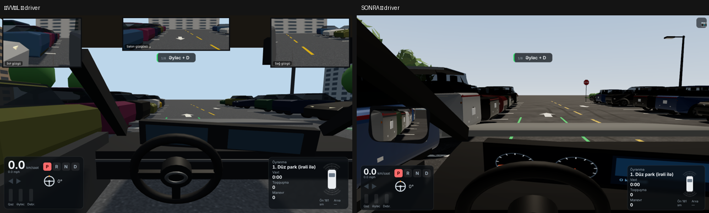
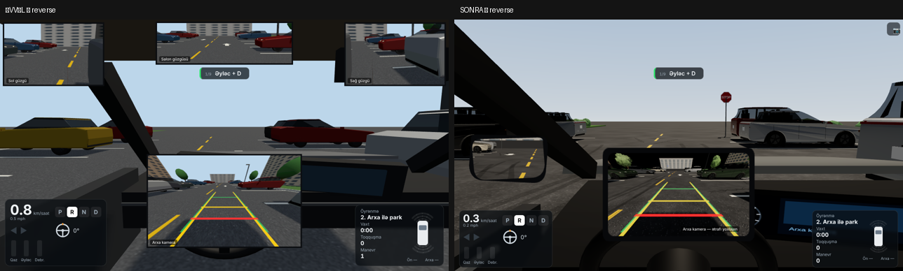
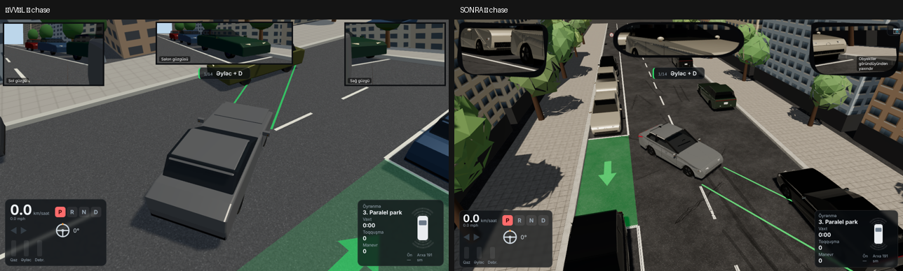
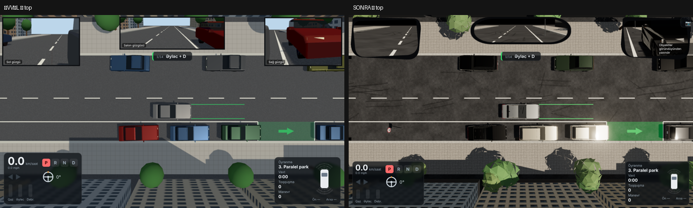

# 🅿️ Park Ustası — 3D park simulyatoru

Brauzerdə işləyən 3D park simulyatoru. Məqsəd real həyatda park etməyi öyrənməkdir: hər səviyyədə **təlimatçı** real istinad nöqtələri ilə addım-addım yol göstərir ("hədəfdən sonrakı xətt arxa təkərinizin bərabərinə gələndə dayanın", "maşın 45° olanda sükanı tam sola çevirin" və s.).

## İşə salmaq

```bash
cd parking-sim
npm install
npm run dev      # http://localhost:5173
npm run build    # dist/ — istənilən statik hostinqə yükləmək olar
npm test         # fizika + izah testləri, 5 səviyyə + 50 təsadüfi məşq variantı (avtomatik sürücü)
npm run test:variants  # geniş yoxlama: 432 məşq düzülüşü fiziki mümkündürmü
npm run build:single  # dist/park-ustasi.html — hər şey daxildə olan tək fayl (telefon üçün link)
```

## Maşın: 2023 Hyundai Elantra SEL (ABŞ)

| Parametr | Dəyər | Mənbə / qeyd |
|---|---|---|
| Uzunluq | 4.676 m (184.1 in) | Hyundai spesifikasiyası, dilerlər |
| En | 1.826 m (71.9 in) | KBB, dilerlər |
| Təkər bazası | 2.720 m (107.1 in) | Hyundai spesifikasiyası |
| İz eni | 1.585 m | J.D. Power (62.4 in) — **təxmini** (təkər ölçüsünə görə dəyişir) |
| Ön / arxa çıxıntı | 0.91 / 1.046 m | **təxmini** — rəsmi rəqəm tapılmadı, 4.676 − 2.720 bölünüb |
| Dönmə radiusu | 5.39 m (17.7 ft) | Hyundai; dairə 35.4 ft (J.D. Power) |
| Sükan nisbəti | 12.9:1 | Hyundai 2021 Elantra spesifikasiyası — 2023 üçün **eyni qəbul edilib** |
| Sükan dövrəsi | 2.48 (±446°) | Hyundai 2021 Elantra spesifikasiyası — **eyni qəbul edilib** |
| Təkərin maksimum bucağı | ≈36° | **hesablanıb**: dönmə radiusundan (velosiped modeli); effektiv nisbət ≈12.4:1 |
| Dönmə radiusunun ölçü nöqtəsi | xarici ön təkərin kənarı | **fərziyyə**: 5.39 m arxa oxun radiusu kimi götürülmür. Testdə: xarici ön təkər 5.38 m, arxa ox 3.75 m, daxili arxa təkər 3.05 m, xarici ön künc 5.91 m |
| Yan güzgülərin çıxıntısı | hər tərəfə 12 sm | **təxmini** (fotolardan); güzgülər toqquşmada yoxlanılır |
| Sükanın ən böyük fırlanma sürəti | ≈540°/s (klaviatura/telefon) | **təxmini** — tam sağdan tam sola ≈1.65 s; fiziki sükanda əl özü məhdudlaşdırır |
| Sürünmə sürəti | ≈4.5 km/saat | **təxmini** (düz asfaltda, qazsız) |
| Park sensoru | standart deyil | 2023 SEL-də yalnız $1,900 Convenience Package ilə (Hyundai qiymət cədvəli, 04.01.2023). Oyunda ayrıca **köməkçi**dir, İmtahanda sönülü |
| Arxa kamera | standart | KBB, CarMax; dinamik xətlərin olması rəsmi təsdiqlənmədi — oyunda dinamik xətlər köməkçi kimi göstərilir |

Salon, sürücünün göz nöqtəsi, güzgülərin və kameranın yeri fotolara əsasən **təxminidir** (`src/carModel.js` → `VIEW`).
Dayanacaq ölçüləri ABŞ-a yaxındır: yer 9×18 ft (2.7×5.5 m), koridor 24 ft, paralel yer 24 ft (7.3 m), küçə 36 ft (11 m).

Mənbələr: [KBB](https://www.kbb.com/hyundai/elantra/2023/specs), [J.D. Power](https://www.jdpower.com/cars/2023/hyundai/elantra/sedan-4d-sel/specs), [Hyundai 2023 spesifikasiyası (PDF)](https://www.hyundainews.com/assets/documents/original/50515-2023ElantraProductSpecifications20220714.pdf), [Hyundai 2021 spesifikasiyası (PDF)](https://www.hyundainews.com/assets/documents/original/50451-446532021ElantraSpecifications20220713.pdf), [Hyundai 2023 qiymət cədvəli (PDF)](https://www.hyundainews.com/assets/documents/original/53437-2023MYElantraPriceSheet04Jan2023.pdf), [CarMax](https://www.carmax.com/car/29180978).

## Real park hissi

| Mövzu | Necə işləyir | Yoxlama (`npm test`) |
|---|---|---|
| Sükan | Çarx 2.48 dövrə, ön təkər ≈36°. Klaviatura/telefonda sükan ani dönmür (≈1.65 s tam sağdan tam sola); buraxanda **mərkəzə qayıtmır** (aşağı sürətdə real maşın kimi) | `tam soldan tam sağa ≥ 1.5 s`, `sükan öz-özünə mərkəzə sıçramır` |
| Arxa təkərlərin içəridən keçməsi | Kinematik velosiped modeli (mənşə arxa oxda) — irəli dönəndə daxili arxa təkər xarici ön təkərdən ~2.3 m içəridən keçir; geri dönəndə ön künc yana açılır. Köməkçi xətt (narıncı) bunu göstərir | `daxili arxa təkər…`, `tam sağ sükanla geri: ön sol künc sola açılır` |
| Qaz/əyləc | D/R-də qazsız sürünmə; az əyləc sürəti tənzimləyir, 30% əyləc saxlayır, tam əyləc 54 sm-də dayandırır. Telefonda pedalı basıb yuxarı sürüşdürdükcə güc artır | `sürünmə`, `yüngül əyləclə…`, `əyləc yolu` |
| Ötürmə | D↔R yalnız dayanıb əyləc basılanda (ayarda söndürülə bilər) | — |
| Toqquşma | Gövdə (bamperlər, künclər) və **yan güzgülər** — hündür maneələrlə; **təkərlər** — bordürlə (gövdənin çıxıntısı alçaq bordürün üstündən keçir). Dəyəndə maşın dayanır, geri sıçramır. Davamlı təmas bir hadisə sayılır. "Ön təkər bordürə dirəndi" və "Toqquşma: ön sağ künc → maşın" ayrıdır | `geri sıçramır`, `davamlı təmas bir toqquşma`, `bordürə ön təkər dirənir`, `yan güzgü…` |
| Kadr sürəti | Fizika sabit 120 Hz addımla — 30/60/144 FPS və nizamsız kadrlarda yol eynidir (fərq 0.0 sm) | `kadr sürətindən asılı deyil`, `düzəliş manevri 30/144 FPS-də eyni yol` |
| Məşq variantları | Yer eni 2.5–2.9 m, başlanğıc zolağı ±35 sm, paralel boşluq 6.7–7.8 m, qonşu maşın 4.45–5.1 m, xəttə yaxın duran qonşu. Təlimatçının yolu hər düzülüşün öz həndəsəsindən hesablanır; bir hərəkətlə mümkün olmayan düzülüş seçilmir | 50 variant + `test:variants` 432/432 |
| İzahlar (`src/advisor.js`) | Maşının həndəsəsindən: "Ön sağ künc yaxınlaşır (32 sm)", "Bu sükanla ~1.2 m sonra sağ güzgü maşına dəyəcək — Tez döndünüz…", "Dayanın, bir az irəli çıxıb bucağı düzəldin". Nəticə ekranında toqquşmanın səbəbi | `tests/advisor.mjs` |
| Köməkçilər mərhələli | Məşqdə hər uğurlu park (2+ ulduz) köməyi azaldır: 1) təlimatçı + xəyali maşın + xətlər → 2) xəyali maşın yox → 3) yalnız xəbərdarlıqlar və arxa kamera xətləri → 4) köməksiz | — |
| Sürücünün gözü | Oturacaq hündürlüyü (±6 sm), irəli/geri (±10 sm), baxış sahəsi (35–70°, susmaya görə 50°) — yadda qalır. Kapotun bir hissəsi görünür, A dirəkləri kor nöqtə yaradır. Yellənmə 6 mm-dən az | brauzerdə yoxlanılıb (şəkillər) |
| Güzgülər | Sol düz ≈18°, sağ qabarıq ≈30°, salon ≈32°, arxa kamera ≈120° (üfüqi; **təxmini**). Yan güzgülərin bucağı ayarlanır; susmaya görə maşının yanı daxili kənarda az görünür. Şəkil güzgü kimi tərsdir | brauzerdə yoxlanılıb |
| Arxa kamera xətləri | Statik (0.5/1/2 m) və sükanla əyilən xətlər ayrı-ayrı söndürülür. Əyilən xətlər fizika ilə eyni düsturla hesablanır. 2023 SEL-də dinamik xətlərin olması **təsdiqlənməyib** — simulyator köməkçisidir | — |
| Səs | Mühərrik: alışma tezliyi dövrdən (sürünmədə ~750 dövr/dəq), qaz yükü ilə dövr və tembr artır. Zəif təkər səsi (yaş asfaltda xışıltılı). Cırıltı və drift yoxdur | — |

**İstinad nöqtələri haqqında:** təlimatçının dediyi nöqtələr ("arxa təkəriniz onun bamperindən ~0.5 m arxada") **həmin düzülüş üçün** hesablanır və məşqdə dəyişir — universal qayda deyil. Real maşında güzgüdə bucağa və məsafəyə baxıb düzəliş edin.

**Hələ yoxdur:** 6.7 m-dən qısa paralel boşluq (çoxhərəkətli giriş tələb edir), yamac, təkərlərin sürüşməsi, real maşınla kalibrlənmiş sürünmə/əyləc əyrisi.

## Qrafika

| Mövzu | Necə |
|---|---|
| Model | Prosedur model (lisenziyalı pulsuz 2023 Elantra GLB modeli tapılmadı; pullu/redaksiya lisenziyalılar istifadə edilmədi). Ölçülər fizika ilə eynidir. Barmaqlıq, nazik faralar, tam enli arxa fənər zolağı, qara C dirəyi, "Z" xətti, akula antenası, 5 cüt qollu tünd disk, qara parça oturacaqlar ağ zolaqlarla, açıq boz tavan — istifadəçinin fotolarına əsasən **təxminidir**, dəqiq Elantra CAD modeli deyil |
| Materiallar | PBR: laklı metallik boya (clearcoat), şüşə (tonlu, salon görünür), xrom, rezin, plastik, parça; asfalt/beton/ot üçün prosedur rəng + kobudluq + normal xəritələri |
| İşıq | ACES Filmic tonlama, sRGB, prosedur səma və ondan PMREM əksolunma, yumşaq kölgələr (PCF), kontakt kölgələri; Ultra-da GTAO (ekran fəzasında AO) və çox zəif bloom |
| Vaxtlar | Günəşli gündüz, axşam, yaş asfalt gecə (fənər dirəkləri işıq saçır, maşının faraları yanır, gölməçələr) |
| Foto rejimi | F və ya 📷 — sərbəst kamera, interfeys gizlənir, fizika dayanır |
| Keyfiyyət | Aşağı / Orta / Yüksək / Ultra / Avtomatik. Seçilmiş pillə heç vaxt özbaşına endirilmir; yalnız "Avtomatik"də 4 s ərzində 48 FPS-dən aşağı olanda bir pillə enir |
| Ölçmə | Ayarlar → "Ölçmə paneli": FPS, kadr vaxtı, draw call (güzgülər daxil), üçbucaq, həndəsə, tekstur, JS yaddaşı |

Ölçülmüş (eyni kadr, Orta, 960×540, proqram renderi SwiftShader): ətraf maşınların birləşdirilməsi ilə draw call 1846 → 669, həndəsə 4417 → 324, JS yaddaşı 48 → 28 MB. FPS rəqəmləri bu mühitdə (GPU-suz) real cihazı göstərmir — öz cihazınızda ölçmə panelini açın.

## Rejimlər

| Rejim | Necə işləyir |
|---|---|
| Öyrənmə | Təlimatçı, köməkçi xətlər, səhvdən geri qayıtma |
| Məşq | Dəyişən yer eni, qonşu maşınlar, başlanğıc; köməkçilər mərhələli azalır |
| İmtahan | Köməksiz manevr, yalnız sürücü görünüşü, daha ciddi qiymətləndirmə |

Qiymətləndirmə ABŞ yol imtahanının məntiqinə yaxındır: toqquşma, xəttdən 30 sm-dən çox çıxma, səhv istiqamət, bordürdən 45 sm-dən (18 düym) uzaq durma — "keçmədi". Bordürə toxunma, əlavə manevr, siqnal və çiyin üstündən baxmamaq bal azaldır.

## Nə var

| Bölmə | Təsvir |
|---|---|
| Fizika (`src/physics.js`) | Velosiped (Ackermann) modeli: arxa təkərlər ön təkərləri izləyir. 2023 Elantra ölçüləri (yuxarıdakı cədvəl), ətalət, avtomat qutuda "sürünmə", ~10 km/saat maksimum, OBB toqquşma |
| Sükan (`src/input.js`) | Gamepad API: Logitech G29/G920, Thrustmaster və s. sükan ±446° (2.48 dövrə), qaz/əyləc/debriyaj ayrı oxlar, D/R/N/P düymələri, kalibrasiya ekranı oxları özü tapır, titrəmə (vibrationActuator) toqquşmada. Sükan yoxdursa klaviatura |
| Kameralar | Sürücü oturacağı (siçanla baxış, B — çiyin üstündən), yuxarıdan, arxadan (C). Sol, sağ və salon güzgüsü ayrıca render olunur. R-də arxa kamera dinamik istiqamət xətləri ilə avtomatik açılır |
| Səviyyələr (`src/levels.js`) | 1. Düz park (irəli ilə) · 2. Arxa ilə park · 3. Paralel park · 4. Maili park (60°) · 5. Dar küçədə 3 hərəkətlə dönmə |
| Təlimatçı (`src/coach.js`) | Maşının vəziyyətinə görə addımlar, "DAYANIN!" xəbərdarlığı, keçəndə düzəliş, yaşıl "ideal maşın" kölgəsi və trayektoriya, istəyə görə səsli |
| Qiymətləndirmə (`src/scoring.js`) | Toqquşma, bordürə toxunma, vaxt, manevr sayı, xəttin içində olmaq, bucaq xətası, mərkəzdən sürüşmə, bordürə məsafə, siqnal, sürət → 100 bal və 3 ulduz |
| Park sensorları | Ön/arxa 8 sensor, yaxınlaşdıqca siqnal sürətlənir, 30 sm-dən az — fasiləsiz səs |
| Dərslər | "Real həyatda park": hazırlıq, sürət nəzarəti, müşahidə, istinad nöqtələri, qaydalar və hər manevrin nəzəriyyəsi |

## Telefon

Telefonda (toxunma ekranı): sükan (fırlanan və ya sağa-sola sürüşdürmə, həssaslıq ayarlanır), ⟲ Düz düyməsi, Əyləc və Qaz pedalları, ortada P/R/N/D (pedallardan uzaqda) və digər düymələr. Ayarlarda düymələrin ölçüsü və pedalların tərəfi dəyişir. Tətbiqdən çıxanda oyun avtomatik pauza olur və pedallar buraxılır. Telefonu üfüqi tutun.

## Klaviatura

W/S — qaz/əyləc · A/D — sükan (Shift sürətli, K mərkəzə) · F — foto rejimi · E/Q və 1–4 — ötürmə · Boşluq — əl əyləci · Z/X — siqnal · C — kamera · V — arxa kamera · B — arxaya baxış · M — güzgülər · H — təlimatçı · G — köməkçi · Enter — bitir · T — yenidən · Esc — pauza

## Qeydlər

- Ötürməni dəyişmək üçün maşın dayanmalı və əyləc basılı olmalıdır (Ayarlarda söndürmək olar).
- Brauzerlər sükanın güc əks-əlaqəsini (mərkəzə qaytaran yay) Gamepad API ilə idarə etməyə imkan vermir — yalnız titrəmə. Yay effektini sükanın proqramında (G HUB və s.) açın.
- Təlimatçının yolları avtomatik sürücü ilə yoxlanılıb: addımlara əməl edəndə 5 səviyyə və bütün məşq variantları toqquşmasız keçilir.

## Əvvəl / sonra (eyni kamera mövqeyi)





